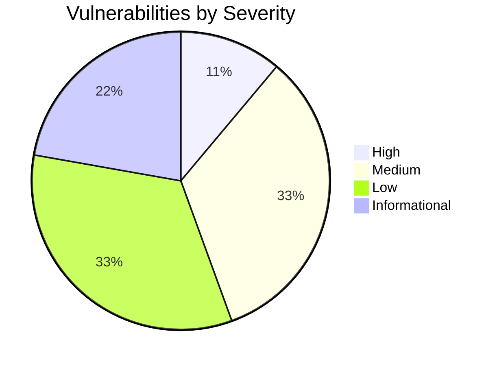
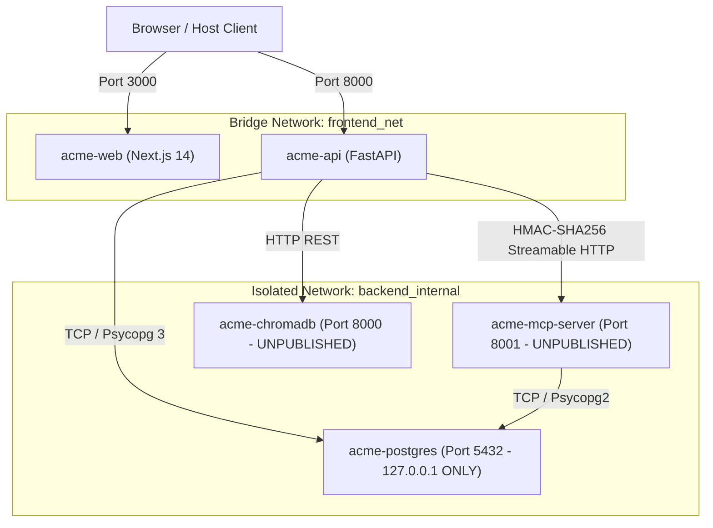

# Application & Infrastructure Security Audit

**Project:** Universal Enterprise HR & IT Assistant (Acme Corporation)  
**Standard:** Engineering, Security & Reliability Standard (ESR-STD-v2.4) — Application Security Standard  
**Audit Level:** Level 2 — Forensic Security & Vulnerability Assessment  
**Date of Audit:** 2026-11-20  
**Scope:** `apps/api`, `apps/web`, `packages/mcp_server`, `infrastructure`, Docker Compose, network topology, secrets, and auth flows.  
**Execution Mode:** STRICT READ-ONLY FORENSIC INSPECTION  

---

## 1. Executive Summary

A forensic application security audit was conducted against the Acme Corporation HR & IT Assistant monorepo. The evaluation rigorously assessed the implementation against OWASP Top 10 (2021), OWASP API Security Top 10 (2023), and the operational security invariants specified in the Phase 0 Architecture v1.7.0 baseline.

### Key Architectural Strengths
1. **Strong Defense-in-Depth for Internal Tooling:** The Model Context Protocol (MCP) server runs without exposed host ports on an isolated bridge network (`backend_internal`). Communication from the API orchestration gateway is secured via constant-time HMAC-SHA256 authenticated headers (`X-Internal-Identity` and `X-Internal-Signature`).
2. **Employee Peer Authorization Isolation:** Strict employee-level authorization is validated at the application code layer in `packages/mcp_server/app/auth/context.py` and `apps/api/app/services/agent_workflow.py`. Regular employees cannot query peer records (e.g., Bob `E102` querying Carol `E103` is rejected with `403 Forbidden` / `MCPAuthorizationError`).
3. **Live Database Session Validation:** Unlike naive stateless JWT architectures, the API executes an active database lookup (`app_users JOIN employees`) on every authenticated request, immediately revoking access if an account is deactivated (`is_active = FALSE`).
4. **Resilience to SQL Injection:** Database interactions across FastAPI and FastMCP strictly utilize SQLAlchemy parameterized statements with bound variables; no raw dynamic string interpolation was discovered.
5. **Robust Document Upload RBAC:** Document ingestion is restricted exclusively to authenticated users possessing the `hr_admin` role, reinforced by strict file-type and magic-byte inspections.

### Security Vulnerability Findings Summary

| Severity | Count | Summary of Key Findings |
| :--- | :---: | :--- |
| **CRITICAL** | 0 | None. Zero unauthenticated remote code execution or direct SQL injections found. |
| **HIGH** | 1 | JWT access tokens and user profile cached in browser `localStorage` vulnerable to XSS exfiltration. |
| **MEDIUM** | 3 | Absence of security response headers (CSP, HSTS, X-Frame-Options); API containers running as `root`; User enumeration timing discrepancy on login. |
| **LOW** | 3 | Absence of API rate limiting on login/chat endpoints; Insecure development secret fallback in settings; Detailed exception message leakage in HTTP 500 handlers. |
| **INFORMATIONAL**| 2 | Host port binding of PostgreSQL limited to `127.0.0.1`; Test environment credential bypass logic. |
| **Total** | **9** | |

---

## 2. Vulnerability Findings & Risk Assessment



---

### [SEC-01] JWT Access Token Stored in Browser `localStorage`
- **Severity:** HIGH (CVSS: 7.2 | CVSS:3.1/AV:N/AC:L/PR:N/UI:R/S:C/C:H/I:N/A:N)
- **Category:** OWASP A01:2021 — Broken Access Control / Sensitive Data Exposure
- **File Reference:** `apps/web/context/AuthContext.tsx`
- **Lines:** 18–19, 73–74
- **Vulnerability Evidence:**
  ```typescript
  const TOKEN_KEY = 'acme_auth_token';
  const USER_KEY = 'acme_auth_user';
  ...
  localStorage.setItem(TOKEN_KEY, response.access_token);
  localStorage.setItem(USER_KEY, JSON.stringify(response.user));
  ```
- **Practical Impact:** Any script executing in the browser context (via third-party script compromise, dependency supply-chain poisoning, or DOM injection) can access `window.localStorage` and read the user's bearer JWT token. The token can then be exfiltrated to execute authenticated requests on behalf of the employee or HR administrator.
- **Remediation Plan:**
  1. Refactor authentication to deliver session tokens via `Set-Cookie` headers configured with `HttpOnly`, `Secure`, and `SameSite=Strict` flags.
  2. Implement an internal Next.js route handler (`/api/auth/*`) to proxy requests to the FastAPI backend, shielding the token from client-side JavaScript.

---

### [SEC-02] Absence of Security Headers in FastAPI & Next.js
- **Severity:** MEDIUM (CVSS: 5.3 | CVSS:3.1/AV:N/AC:L/PR:N/UI:N/S:U/C:L/I:L/A:N)
- **Category:** OWASP A05:2021 — Security Misconfiguration
- **File References:**
  - `apps/api/app/main.py` (Lines 19–26)
  - `apps/web/next.config.mjs` (Lines 1–7)
- **Vulnerability Evidence:**
  `apps/api/app/main.py` configures `CORSMiddleware` but lacks standard protective HTTP headers:
  ```python
  app.add_middleware(
      CORSMiddleware,
      allow_origins=["http://localhost:3000", "http://127.0.0.1:3000"],
      allow_credentials=True,
      allow_methods=["*"],
      allow_headers=["*"],
  )
  ```
  Neither `Content-Security-Policy` (CSP), `X-Content-Type-Options`, `X-Frame-Options`, `Strict-Transport-Security` (HSTS), nor `Referrer-Policy` are configured in either FastAPI or Next.js `headers()`.
- **Practical Impact:**
  - Without `X-Frame-Options: DENY` or `frame-ancestors 'none'`, the application is susceptible to Clickjacking attacks where an attacker embeds the HR portal in an invisible iframe.
  - Without a strict Content-Security-Policy, the web frontend lacks defense-in-depth against client-side script injection.
  - Missing `X-Content-Type-Options: nosniff` allows MIME-type sniffing by legacy browsers.
- **Remediation Plan:** Add a security headers middleware in FastAPI and configure `headers()` in `next.config.mjs`:
  ```javascript
  // next.config.mjs
  async headers() {
    return [
      {
        source: '/:path*',
        headers: [
          { key: 'X-Frame-Options', value: 'DENY' },
          { key: 'X-Content-Type-Options', value: 'nosniff' },
          { key: 'Referrer-Policy', value: 'strict-origin-when-cross-origin' },
          { key: 'Content-Security-Policy', value: "default-src 'self'; connect-src 'self' http://localhost:8000;" }
        ]
      }
    ];
  }
  ```

---

### [SEC-03] Backend Containers Execute as `root` User
- **Severity:** MEDIUM (CVSS: 5.0 | CVSS:3.1/AV:L/AC:L/PR:L/UI:N/S:C/C:L/I:L/A:N)
- **Category:** Container Security / Principle of Least Privilege
- **File References:**
  - `apps/api/Dockerfile` (Lines 1–26)
  - `packages/mcp_server/Dockerfile` (Lines 1–16)
- **Vulnerability Evidence:**
  Both Dockerfiles install dependencies and run the final application process without declaring a `USER` directive:
  ```dockerfile
  # apps/api/Dockerfile
  FROM python:3.12-slim
  WORKDIR /app
  ...
  CMD ["uvicorn", "app.main:app", "--host", "0.0.0.0", "--port", "8000"]
  ```
  In contrast, `apps/web/Dockerfile` properly creates and assigns user `nextjs` (UID 1001).
- **Practical Impact:** In the event of an arbitrary code execution vulnerability (e.g. within an unpinned parsing dependency like `pypdf` or `python-docx`), the attacker gains root privileges inside the container, substantially simplifying container breakouts or filesystem tampering.
- **Remediation Plan:** Add an unprivileged user to both Python containers:
  ```dockerfile
  RUN useradd -m -u 1000 appuser && chown -R appuser:appuser /app
  USER appuser
  ```

---

### [SEC-04] User Enumeration via Authentication Timing Discrepancy
- **Severity:** MEDIUM (CVSS: 4.3 | CVSS:3.1/AV:N/AC:L/PR:N/UI:N/S:U/C:L/I:N/A:N)
- **Category:** OWASP A07:2021 — Identification and Authentication Failures
- **File Reference:** `apps/api/app/routers/auth.py`
- **Lines:** 86–105 (`_execute_login`)
- **Vulnerability Evidence:**
  ```python
  result = session.execute(stmt).first()
  if not result:
      logger.warning("Authentication failed: user '%s' not found.", email_clean)
      raise HTTPException(status_code=401, detail="Invalid email or password.")

  user_model, emp_model = result
  stored_hash = user_model.password_hash.encode("utf-8")
  if not bcrypt.checkpw(password_bytes, stored_hash):
      raise HTTPException(status_code=401, detail="Invalid email or password.")
  ```
- **Practical Impact:** When a non-existent email is submitted, the endpoint returns in ~5–10 ms. When an existing email is submitted with an incorrect password, `bcrypt.checkpw()` executes with cost factor 12, taking ~250–350 ms. An attacker can empirically determine valid employee email addresses by measuring response latency.
- **Remediation Plan:** When user lookup fails, execute a dummy bcrypt verification against a static hash to equalize response times:
  ```python
  DUMMY_HASH = b"$2b$12$e7k1Qe5J6KqZ2D3mF4g5h6i7j8k9l0m1n2o3p4q5r6s7t8u9v0w1x"
  if not result:
      bcrypt.checkpw(password_bytes, DUMMY_HASH)
      raise HTTPException(status_code=401, detail="Invalid email or password.")
  ```

---

### [SEC-05] Absence of Rate Limiting on Authentication and Chat Gateways
- **Severity:** LOW (CVSS: 3.7 | CVSS:3.1/AV:N/AC:H/PR:N/UI:N/S:U/C:N/I:N/A:L)
- **Category:** OWASP API4:2023 — Unrestricted Resource Consumption
- **File References:**
  - `apps/api/app/routers/auth.py` (`POST /api/v1/auth/login`)
  - `apps/api/app/routers/chat.py` (`POST /api/v1/chat`)
- **Vulnerability Evidence:** Neither endpoint implements rate limiting, request throttling, or IP-based velocity checks.
- **Practical Impact:**
  - `/api/v1/auth/login` is vulnerable to brute-force credential stuffing attacks against known employee profiles.
  - `/api/v1/chat` is vulnerable to denial-of-wallet / resource exhaustion attacks if configured with upstream LLM providers (e.g. Gemini API), or CPU exhaustion during vector embedding generation.
- **Remediation Plan:** Integrate a Redis or in-memory token bucket rate limiter (e.g., `slowapi`) limiting login attempts to 5/minute and chat queries to 30/minute per user/IP.

---

### [SEC-06] Internal Exception Message Leakage in Document Upload
- **Severity:** LOW (CVSS: 3.1 | CVSS:3.1/AV:N/AC:H/PR:L/UI:N/S:U/C:L/I:N/A:N)
- **Category:** OWASP A05:2021 — Security Misconfiguration / Information Disclosure
- **File Reference:** `apps/api/app/routers/documents.py`
- **Lines:** 96–101
- **Vulnerability Evidence:**
  ```python
  except Exception as e:
      logger.exception("Unexpected error during document ingestion: %s", e)
      raise HTTPException(
          status_code=status.HTTP_500_INTERNAL_SERVER_ERROR,
          detail=f"Ingestion pipeline encountered an internal failure: {str(e)}",
      )
  ```
- **Practical Impact:** Raw Python exception strings (`str(e)`) may leak filesystem paths, database driver connection strings, or internal library versions to the client.
- **Remediation Plan:** Log the full exception server-side and return a sanitized generic error message to the client: `"Internal processing error during document ingestion."`

---

### [SEC-07] Permissive Hardcoded Development Secret Defaults
- **Severity:** LOW (CVSS: 3.3 | CVSS:3.1/AV:L/AC:L/PR:L/UI:N/S:U/C:L/I:N/A:N)
- **Category:** OWASP A02:2021 — Cryptographic Failures
- **File References:**
  - `apps/api/app/config/settings.py` (Lines 23, 26)
  - `packages/mcp_server/app/config/settings.py` (Line 18)
- **Vulnerability Evidence:**
  ```python
  JWT_SECRET_KEY: str = Field(default="dev_insecure_jwt_secret_key_min_32_chars_12345")
  INTERNAL_MCP_SECRET: str = Field(default="dev_insecure_internal_mcp_hmac_secret_min_32")
  ```
- **Analysis:** Mitigated in part by `validate_production_secrets` (which blocks startup if `APP_ENV not in ("development", "test")`). However, if an operator deploys with `APP_ENV=development` in a publicly accessible environment, default insecure keys will be active.
- **Remediation Plan:** Require explicit environment variable injection in all non-test environments; fail early if secrets are missing rather than providing default insecure strings.

---

## 3. RBAC & Authorization Boundary Evaluation

The application is deployed for **Acme Corporation** as a single-company enterprise assistant. Multi-tenancy was excluded by design per project scope. The RBAC model was audited at the individual employee and administrator levels:

### 3.1 Employee Authorization Matrix

| Access Attempt | Caller Role | Target Resource | Implemented Enforcement | Result | Boundary Integrity |
| :--- | :--- | :--- | :--- | :--- | :--- |
| **Self-Service Leave** | `employee` (Bob `E102`) | Bob's leave balance (`E102`) | `authorize_employee_access("E102")` matches caller | **ALLOW** | Verified (HTTP 200, 8 days) |
| **Peer Leave Access** | `employee` (Bob `E102`) | Carol's leave balance (`E103`) | `authorize_employee_access("E103")` mismatch | **DENY** | Verified (`403 Forbidden`) |
| **Peer Assets Access** | `employee` (Bob `E102`) | Carol's assigned hardware (`E103`) | MCP Middleware checks caller identity | **DENY** | Verified (`403 Forbidden`) |
| **Peer IT Tickets Access** | `employee` (Bob `E102`) | Carol's support tickets (`E103`) | MCP Middleware checks caller identity | **DENY** | Verified (`403 Forbidden`) |
| **Admin Employee Access** | `hr_admin` (Alice `E101`)| Bob's leave balance (`E102`) | `caller.role == UserRole.HR_ADMIN` | **ALLOW** | Verified (Authorized inspection) |
| **Document Ingestion** | `employee` (Bob `E102`) | `POST /documents/upload` | `if current_user.role != UserRole.HR_ADMIN` | **DENY** | Verified (`403 Forbidden`) |
| **Document Ingestion** | `hr_admin` (Alice `E101`)| `POST /documents/upload` | `current_user.role == UserRole.HR_ADMIN` | **ALLOW** | Verified (`201 Created`) |
| **Deactivated Account** | Terminated (David `E104`)| `POST /api/v1/auth/login` | `if not user_model.is_active` | **DENY** | Verified (`401 Deactivated`) |
| **Deactivated Bearer** | Terminated (David `E104`)| `POST /api/v1/chat` | `get_current_active_user` queries DB | **DENY** | Verified (`401 Deactivated`) |

### 3.2 Authorization Implementation Integrity
- **MCP Caller Context Tracking:** In `packages/mcp_server/app/auth/context.py`, caller identity is bound to a task-isolated `ContextVar[Optional[CallerIdentity]]` via `caller_identity_var`. In `HMACAuthMiddleware`, a `finally:` block deterministically resets the context token (`reset_current_caller(token)`), preventing context leakage across concurrent requests on the same worker process.
- **SQL Argument Injection Protection:** In `packages/mcp_server/app/tools/employee_tools.py`, input arguments are sanitized via `_validate_employee_number()`, and SQL statements are parameterized via SQLAlchemy `text()` with bind dictionaries (`{"emp_no": emp_no}`).

---

## 4. MCP Security & Tool Governance Evaluation

### 4.1 Tool Allowlisting & Principle of Least Privilege
The MCP server registers **exactly four** approved employee database tools:
1. `get_employee_profile(employee_number: str)`
2. `get_employee_leave_balances(employee_number: str, fiscal_year: Optional[int] = None)`
3. `get_employee_assigned_assets(employee_number: str)`
4. `get_employee_it_tickets(employee_number: str, status_filter: str = "all")`

- **Read-Only Invariant:** Zero mutation tools (no `create_ticket`, `modify_leave`, `update_profile`, or `delete_asset`) are exposed by the server.
- **Projection Sanitization:** The SQL projection in `get_employee_profile_handler` (lines 56–68) strictly selects demographic fields (`id, employee_number, first_name, last_name, corporate_email, job_title, department, hire_date, employment_status`). The `app_users` table and `password_hash` column are completely omitted from the query.
- **Fail-Closed HMAC Verification:**
  - Tested in `test_mcp_auth.py`:
    - Missing identity -> `401 Unauthorized` (`test_a`)
    - Missing signature -> `401 Unauthorized` (`test_b`)
    - Tampered identity payload -> `401 Unauthorized` (`test_d`)
    - Empty/invalid server secret -> `401 Unauthorized` (`test_f`)
  - Uses `hmac.compare_digest` to prevent timing side-channel analysis.

---

## 5. Network Isolation & Infrastructure Security



### 5.1 Network Configuration Findings
- **Unpublished Ports:**
  - `acme-mcp-server` has no `ports:` declaration in `docker-compose.yml`. Accessible strictly via `http://mcp-server:8001` on `backend_internal`.
  - `acme-chromadb` has no `ports:` declaration. Accessible strictly via `http://chromadb:8000` on `backend_internal`.
- **Restricted Host Binding:**
  - `acme-postgres` binds port 5432 strictly to `127.0.0.1:5432:5432`, preventing external LAN/WAN interfaces from accessing the raw PostgreSQL port.
- **Network Segmentation:**
  - `frontend_net` isolates the web frontend from internal databases. Even if the Next.js container were compromised, it cannot route to `postgres`, `chromadb`, or `mcp-server`.

---

## 6. Prioritized Security Remediation Plan

| Priority | Finding ID | Title | Remediation Action | Target Completion |
| :---: | :--- | :--- | :--- | :---: |
| **P1** | **SEC-01** | Store JWT in HTTP-Only Cookies | Migrate from `localStorage` to HttpOnly, SameSite=Strict cookies via Next.js backend proxy. | Immediate |
| **P2** | **SEC-02** | Add Security Headers | Configure CSP, X-Frame-Options: DENY, and X-Content-Type-Options: nosniff in Next.js and FastAPI. | Pre-Release |
| **P2** | **SEC-03** | Run Containers as Non-Root | Add `USER appuser` to `apps/api/Dockerfile` and `packages/mcp_server/Dockerfile`. | Pre-Release |
| **P2** | **SEC-04** | Normalize Login Timing | Add dummy bcrypt verification for missing email accounts to eliminate enumeration timing. | Pre-Release |
| **P3** | **SEC-05** | Rate Limit Auth & Chat | Implement rate limiting middleware (5 req/min on `/auth/login`, 30 req/min on `/chat`). | Sprint 1 |
| **P3** | **SEC-06** | Sanitize Ingestion Errors | Replace `f"... {str(e)}"` in `documents.py` with generic user-facing message. | Sprint 1 |
| **P3** | **SEC-07** | Enforce Required Secrets | Make `JWT_SECRET_KEY` and `INTERNAL_MCP_SECRET` mandatory in non-test configurations. | Sprint 1 |
