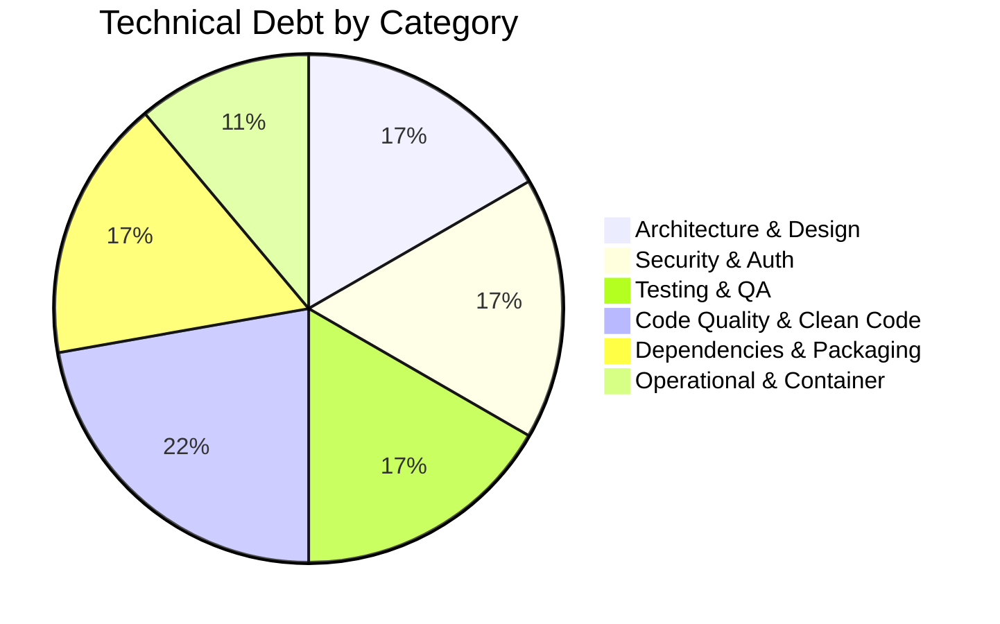
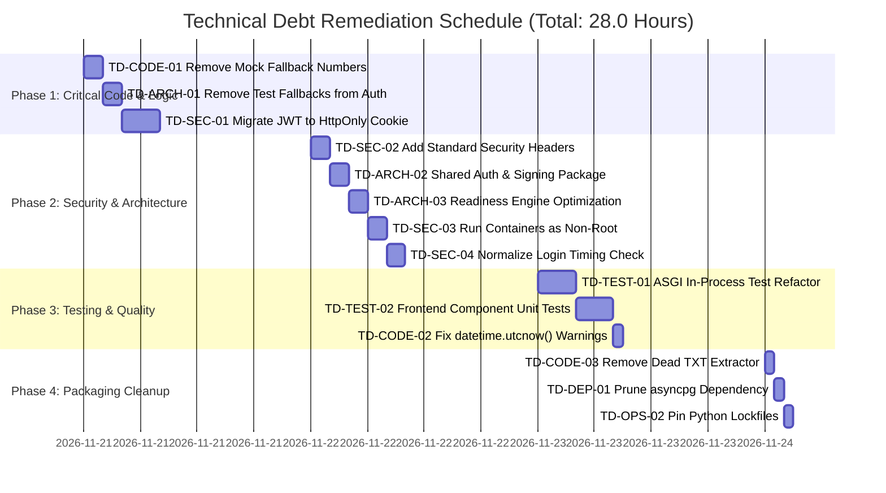

# Technical Debt Register

**Project:** Universal Enterprise HR & IT Assistant (Acme Corporation)  
**Standard:** Engineering, Security & Reliability Standard (ESR-STD-v2.4) — Technical Debt & Production Readiness  
**Audit Level:** Level 2 — Forensic Codebase Verification  
**Date of Assessment:** 2026-11-20  
**Scope:** `apps/api`, `apps/web`, `packages/mcp_server`, `infrastructure`, Docker Compose, dependencies, tests, and configuration.  
**Execution Mode:** STRICT READ-ONLY FORENSIC INSPECTION  

---

## 1. Executive Summary

This register catalogs all architectural, code quality, testing, security, dependency, and operational technical debt identified during the Level 2 forensic audit of the Acme Corporation HR & IT Assistant.

Each debt item is indexed with its exact file and line references, estimated remediation effort (story points / developer hours), risk rating, and recommended resolution path.

### Technical Debt Overview

| Category | High Priority | Medium Priority | Low Priority | Total Items | Est. Payoff Effort |
| :--- | :---: | :---: | :---: | :---: | :---: |
| **Architecture & Design** | 1 | 2 | 0 | 3 | 5.5 hours |
| **Security & Auth** | 1 | 2 | 0 | 3 | 7.0 hours |
| **Testing & QA** | 0 | 2 | 1 | 3 | 8.0 hours |
| **Code Quality & Clean Code** | 1 | 1 | 2 | 4 | 3.5 hours |
| **Dependencies & Packaging** | 0 | 1 | 2 | 3 | 1.5 hours |
| **Operational & Container** | 0 | 1 | 1 | 2 | 2.5 hours |
| **Total** | **3** | **9** | **6** | **18** | **28.0 hours** |

---

## 2. Complete Technical Debt Inventory

### 2.1 Architecture & Design Debt

#### [TD-ARCH-01] Hardcoded Test Mocks in Production Router Logic
- **Category:** Architecture & Design Debt
- **File Reference:** `apps/api/app/routers/auth.py` (Lines 140–181) & `apps/api/app/core/auth.py` (Lines 164–176, 197–204)
- **Description:** The production login handler (`_execute_login`) and authentication dependency (`get_current_active_user`) contain explicit conditional blocks checking `if settings.APP_ENV == "test":` with hardcoded dictionaries of mock employees and passwords (`Password123!`).
- **Debt Impact:** Violates separation of concerns. If `APP_ENV=test` is accidentally set in non-isolated environments, authentication against the live database is bypassed. Test logic pollutes production request pathways.
- **Remediation Cost:** 2.0 hours
- **Priority:** **P1 (High)**
- **Remediation Plan:** Refactor test suites to inject mock session factories via FastAPI's `app.dependency_overrides[get_auth_session_factory]`. Remove all synthetic user dictionaries from `auth.py`.

#### [TD-ARCH-02] Code Duplication in Cryptographic HMAC Signing Utilities
- **Category:** Architecture & Design Debt
- **File References:**
  - `packages/mcp_server/app/auth/signer.py` (Lines 14–39)
  - `apps/api/app/services/mcp_client.py` (Lines 55–80)
- **Description:** `create_internal_auth_headers()` is duplicated verbatim across the API gateway and the MCP server. Both files independently implement HMAC-SHA256 signature generation over JSON identity payloads.
- **Debt Impact:** High risk of drift. Any update to JSON serialization flags (e.g. separators, key sorting, timestamp fields) made in one location will cause HMAC validation failures in the other.
- **Remediation Cost:** 2.0 hours
- **Priority:** **P2 (Medium)**
- **Remediation Plan:** Consolidate shared authentication schemas (`CallerIdentity`, `UserRole`) and HMAC utilities into a local shared monorepo package (e.g., `packages/common_auth`).

#### [TD-ARCH-03] Ephemeral Database Engine Recreation in Readiness Probe
- **Category:** Architecture & Design Debt
- **File Reference:** `apps/api/app/routers/health.py` (Lines 21–44)
- **Description:** The `check_postgres()` function calls `create_engine()` and `engine.dispose()` on every invocation of `/health/ready`.
- **Debt Impact:** Induces repeated TCP connection handshakes and SSL negotiation on PostgreSQL under continuous container or orchestrator health polling (every 5 seconds).
- **Remediation Cost:** 1.5 hours
- **Priority:** **P2 (Medium)**
- **Remediation Plan:** Leverage the global cached SQLAlchemy session factory to execute `SELECT 1` through a pooled, pre-existing connection with an explicit 2-second timeout.

---

### 2.2 Security & Authentication Debt

#### [TD-SEC-01] JWT Bearer Token Cached in Browser `localStorage`
- **Category:** Security Debt
- **File Reference:** `apps/web/context/AuthContext.tsx` (Lines 18–19, 73–74)
- **Description:** The Next.js frontend stores the signed JWT token in `window.localStorage` under the key `acme_auth_token`.
- **Debt Impact:** Increases exposure to Cross-Site Scripting (XSS). Any compromised client script can extract the active JWT and impersonate the employee or HR administrator.
- **Remediation Cost:** 4.0 hours
- **Priority:** **P1 (High)**
- **Remediation Plan:** Migrate session token delivery to secure, `HttpOnly`, `SameSite=Strict` cookies issued by a Next.js server-side route handler that proxies requests to the FastAPI backend.

#### [TD-SEC-02] Missing Standard Security Response Headers
- **Category:** Security Debt
- **File References:**
  - `apps/api/app/main.py` (Lines 19–26)
  - `apps/web/next.config.mjs` (Lines 1–7)
- **Description:** Neither FastAPI nor Next.js emits standard defense-in-depth headers such as `Content-Security-Policy`, `X-Frame-Options`, `X-Content-Type-Options`, `Referrer-Policy`, or `Strict-Transport-Security`.
- **Debt Impact:** Susceptible to Clickjacking (lack of frame-ancestors / X-Frame-Options), MIME-type sniffing, and unconstrained script origins.
- **Remediation Cost:** 1.5 hours
- **Priority:** **P2 (Medium)**
- **Remediation Plan:** Add a security header middleware to FastAPI and declare global response headers in `next.config.mjs`.

#### [TD-SEC-03] Timing Side-Channel in User Authentication
- **Category:** Security Debt
- **File Reference:** `apps/api/app/routers/auth.py` (Lines 86–105)
- **Description:** When an invalid email is provided, login terminates immediately (~5 ms). When a valid email is provided with an incorrect password, `bcrypt.checkpw` runs (~300 ms).
- **Debt Impact:** Allows an unauthenticated attacker to enumerate active employee email addresses via latency measurements.
- **Remediation Cost:** 1.5 hours
- **Priority:** **P2 (Medium)**
- **Remediation Plan:** Execute a constant-time dummy bcrypt check when user lookup yields no matching record.

---

### 2.3 Code Quality & Clean Code Debt

#### [TD-CODE-01] Hardcoded Acme Fallbacks in Mock LLM Synthesis Engine
- **Category:** Code Quality / Logic Debt
- **File Reference:** `apps/api/app/services/llm_service.py` (Lines 298–335)
- **Description:** In `_synthesize_local()`, if regex matching fails on retrieved document chunks, the function silently substitutes hardcoded Acme numbers: `"18"` (vacation), `"5"` (rollover), `"10"` (sick), `"36"` (refresh), `"24"` (screen ticket), and `"300"` (stipend).
- **Debt Impact:** Directly breaks the "Document-Driven Truth" principle during mock and automated regression evaluations. If an ingested policy document changes policy numbers, regex parsing failures will silently output outdated hardcoded figures instead of reporting an extraction failure.
- **Remediation Cost:** 1.5 hours
- **Priority:** **P1 (High)**
- **Remediation Plan:** Remove all hardcoded numeric constants from `_synthesize_local`. Output an unparsed textual snippet or state that the exact numerical rule could not be parsed with high confidence.

#### [TD-CODE-02] Usage of Deprecated `datetime.utcnow()`
- **Category:** Clean Code Debt
- **File References:**
  - `apps/api/app/models/document.py` (Lines 38, 49)
  - `apps/api/app/models/user.py` (Lines 45, 52, 84, 91)
- **Description:** Model timestamps declare `default=datetime.utcnow`. Deprecated in Python 3.12.
- **Debt Impact:** Triggers 72 warning notices during every pytest test run. May fail in future Python 3.13+ releases.
- **Remediation Cost:** 0.5 hours
- **Priority:** **P2 (Medium)**
- **Remediation Plan:** Replace `default=datetime.utcnow` with `default=lambda: datetime.now(timezone.utc)`.

#### [TD-CODE-03] Dead TXT Document Extraction Function
- **Category:** Clean Code Debt
- **File Reference:** `apps/api/app/services/document_extractor.py` (Lines 270–305)
- **Description:** `extract_from_txt()` is fully implemented, but `.txt` files are strictly rejected with `UnsupportedFormatError` by `document_validation.py`.
- **Debt Impact:** Dead code increases cognitive load and maintenance overhead.
- **Remediation Cost:** 0.5 hours
- **Priority:** **P3 (Low)**
- **Remediation Plan:** Delete `extract_from_txt()` or explicitly add `.txt` to `SUPPORTED_EXTENSIONS` if plain text files should be supported.

#### [TD-CODE-04] Duplicate Seed SQL Files in Monorepo
- **Category:** Clean Code Debt
- **File References:**
  - `infrastructure/postgres/init/002_seed.sql`
  - `data/seeds/seed.sql`
- **Description:** Two identical 203-line SQL scripts exist in two distinct folders.
- **Debt Impact:** Maintenance hazard. Updates to seed datasets risk being applied to one file and missed in the other.
- **Remediation Cost:** 1.0 hour
- **Priority:** **P3 (Low)**
- **Remediation Plan:** Remove `data/seeds/seed.sql` and make `infrastructure/postgres/init/002_seed.sql` the canonical seed script.

---

### 2.4 Testing & QA Debt

#### [TD-TEST-01] Flaky In-Process Thread / Loopback Integration Tests
- **Category:** Testing Debt
- **File References:**
  - `packages/mcp_server/tests/test_employee_tools.py` (Line 619: `test_f1...`)
  - `packages/mcp_server/tests/test_mcp_startup.py` (Line 76: `test_mcp_protocol...`)
  - `apps/api/tests/test_ingestion.py` (Line 420: `test_16...`)
- **Description:** Several test functions spin up background Uvicorn servers or instantiate Starlette `TestClient` over localhost sockets. In sandboxed or containerized Windows environments where inter-thread or localhost loopback TCP socket connects are blocked, these tests hang or time out.
- **Debt Impact:** Causes test suite fragility in automated CI/CD environments and sandboxed developer workstations.
- **Remediation Cost:** 3.5 hours
- **Priority:** **P2 (Medium)**
- **Remediation Plan:** Separate protocol loopback tests into an explicit end-to-end integration test file (`tests/e2e/`), and use in-process ASGI transports (`httpx.ASGITransport`) for unit and regression testing.

#### [TD-TEST-02] Missing Frontend React Component Unit Tests
- **Category:** Testing Debt
- **File Reference:** `apps/web/tests/verify_frontend.mjs`
- **Description:** The frontend test suite only tests the plain JavaScript `api` client. There are zero automated component tests for `ChatInterface.tsx`, `LoginForm.tsx`, or `DocumentUploadModal.tsx`.
- **Debt Impact:** UI regressions, accessibility gaps (ARIA), and modal state errors cannot be detected by CI before deployment.
- **Remediation Cost:** 3.5 hours
- **Priority:** **P2 (Medium)**
- **Remediation Plan:** Introduce `@testing-library/react` and Vitest/Jest to assert component rendering, input state management, and role-based modal visibility.

#### [TD-TEST-03] Untested API Rate Limiting Boundaries
- **Category:** Testing Debt
- **File Reference:** `apps/api/tests`
- **Description:** No test cases exist to verify request rate limiting, concurrency saturation, or brute-force throttling on `/api/v1/auth/login` or `/api/v1/chat`.
- **Debt Impact:** Security boundaries for denial-of-service or credential stuffing cannot be empirically audited.
- **Remediation Cost:** 1.0 hour
- **Priority:** **P3 (Low)**
- **Remediation Plan:** Implement rate limiting middleware and create unit tests asserting `HTTP 429 Too Many Requests` upon exceeding request velocity limits.

---

### 2.5 Dependencies & Packaging Debt

#### [TD-DEP-01] Unused `asyncpg` Driver in Both Services
- **Category:** Dependencies Debt
- **File References:**
  - `apps/api/requirements.txt` (Line 7)
  - `packages/mcp_server/requirements.txt` (Line 6)
- **Description:** `asyncpg` is specified in dependencies, but neither `apps/api` nor `packages/mcp_server` utilizes asynchronous database drivers (they use `psycopg[binary]` and `psycopg2-binary` respectively).
- **Debt Impact:** Bloats container build times and expands third-party package surface area.
- **Remediation Cost:** 0.5 hours
- **Priority:** **P3 (Low)**
- **Remediation Plan:** Remove `asyncpg` from both `requirements.txt` files.

#### [TD-DEP-02] Missing `"type": "module"` in `apps/web/package.json`
- **Category:** Packaging Debt
- **File Reference:** `apps/web/package.json`
- **Description:** Package type is omitted, causing Node.js to emit module resolution warnings during test scripts.
- **Debt Impact:** Runtime warning noise in CI logs.
- **Remediation Cost:** 0.25 hours
- **Priority:** **P3 (Low)**
- **Remediation Plan:** Add `"type": "module"` to `apps/web/package.json`.

#### [TD-DEP-03] Loose Catch Block Typing in Frontend API Client
- **Category:** Code Quality / Typing Debt
- **File Reference:** `apps/web/lib/api.ts` (Lines 42, 100)
- **Description:** Errors and response payloads in catch blocks are typed as `any`.
- **Debt Impact:** Disables TypeScript compiler type checking on error handling branches.
- **Remediation Cost:** 0.75 hours
- **Priority:** **P3 (Low)**
- **Remediation Plan:** Replace `any` with `unknown` and assert error properties with type guards.

---

### 2.6 Operational & Container Debt

#### [TD-OPS-01] Backend Containers Execute as `root`
- **Category:** Operational Debt
- **File References:**
  - `apps/api/Dockerfile`
  - `packages/mcp_server/Dockerfile`
- **Description:** Python containers run as root; no unprivileged `USER` is defined.
- **Debt Impact:** Violates container security best practices; elevates severity of potential code execution vulnerabilities.
- **Remediation Cost:** 1.5 hours
- **Priority:** **P2 (Medium)**
- **Remediation Plan:** Create and assign an unprivileged `appuser` (UID 1000) in both Dockerfiles.

#### [TD-OPS-02] Unpinned Package Ranges in Python Requirements
- **Category:** Operational Debt
- **File References:**
  - `apps/api/requirements.txt` (e.g. `langgraph>=0.2.50`, `chromadb>=0.5.20`, `bcrypt>=4.0.0`)
  - `packages/mcp_server/requirements.txt` (e.g. `psycopg2-binary>=2.9.9`, `httpx>=0.27.0`)
- **Description:** Dependencies use loose `>=` ranges without upper bounds or lockfiles (`requirements.lock`).
- **Debt Impact:** Rebuilding images in the future may pull breaking minor/major library updates.
- **Remediation Cost:** 1.0 hour
- **Priority:** **P3 (Low)**
- **Remediation Plan:** Generate explicit `requirements.lock` files using `pip-compile` to ensure deterministic container builds.

---

## 3. Technical Debt Payoff Roadmap

| Phase | Milestone Goal | Included Debt Items | Total Hours |
| :---: | :--- | :--- | :---: |
| **Phase 1: Immediate** | Core Logic & Critical Auth | `TD-CODE-01`, `TD-ARCH-01`, `TD-SEC-01` | **8.0 hrs** |
| **Phase 2: Pre-Release**| Architecture & Container Security | `TD-SEC-02`, `TD-ARCH-02`, `TD-ARCH-03`, `TD-SEC-03`, `TD-SEC-04` | **9.0 hrs** |
| **Phase 3: QA Sprint** | Test Stability & Code Modernization | `TD-TEST-01`, `TD-TEST-02`, `TD-CODE-02`, `TD-TEST-03` | **9.5 hrs** |
| **Phase 4: Polish** | Dependencies & File Cleanup | `TD-CODE-03`, `TD-CODE-04`, `TD-DEP-01`, `TD-DEP-02`, `TD-DEP-03`, `TD-OPS-02` | **3.5 hrs** |
