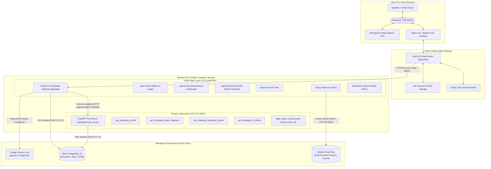

# Universal Enterprise HR & IT Assistant — Cloud Deployment Architecture

**Standard:** ESR-STD-v2.4  
**Date:** November 23, 2026  
**Document ID:** `ARCH-CLOUD-DEPLOY-001`  
**Status:** APPROVED FOR IMPLEMENTATION  

---

## 1. High-Level Architectural Diagram

---

## 2. Network Security Boundaries & Zero-Trust Verification

### 2.1 Public Internet to Vercel
* All frontend traffic is routed over HTTP/2 and HTTP/3 with TLS 1.3 certificates provisioned and rotated automatically by Vercel Edge.
* The browser strictly enforces Web Speech API microphone security: microphone access is only granted on secure origins (`https://` or `localhost`).

### 2.2 Vercel to Render Backend
* Requests originate from `https://*.vercel.app` to `https://acme-api.onrender.com`.
* **CORS Enforcement:** The FastAPI backend inspects the `Origin` header against `CORS_ORIGINS`. Pre-flight `OPTIONS` requests are handled cleanly without exposing private endpoints.
* **Authentication:** Every API request (except `/api/v1/auth/login` and `/health/live`) requires a valid `Authorization: Bearer <JWT>` header containing signed employee metadata (`sub`, `employee_number`, `role`, `department`).

### 2.3 FastAPI to FastMCP Tool Server (Strict Isolation)
* **The Problem:** Render Free does not offer private internal network services without a paid subscription ($7/mo per service). Exposing FastMCP as a public web service would violate **Section 7: MCP Deployment & Network Security**.
* **The Architectural Solution:** 
  1. The container runs both FastAPI and FastMCP.
  2. FastMCP binds strictly to `127.0.0.1:8001` inside the container.
  3. Render's public router maps external traffic **only** to `$PORT` (FastAPI). Port `8001` is physically inaccessible from any external IP, domain, or host outside the container.
  4. FastAPI communicates with FastMCP over local loopback (`http://127.0.0.1:8001`).
  5. Every request transmits the canonical `X-Internal-Identity` header signed with an `X-Internal-Signature` HMAC-SHA256 token using `INTERNAL_MCP_SECRET`.

---

## 3. Transactional Integrity & State Isolation

### 3.1 Human-in-the-Loop (HITL) Execution Boundary
All transactional actions (leave booking, leave cancellation, equipment requests, reimbursements, IT tickets) enforce strict confirmation boundaries:
1. **Draft Stage:** When an employee verbally or textually requests a transaction (e.g. *"Book 2 days leave"*), Archie and the LLM draft the transaction and generate an interactive **Confirmation Card** in the UI.
2. **Execution Gate:** No transaction is committed until the user explicitly clicks the physical **Confirm** button in the UI. Spoken confirmations (*"Yes, confirm"*) are intentionally refused with a friendly security prompt requiring physical UI interaction.
3. **Database Concurrency:** In Neon PostgreSQL, the transaction manager utilizes row-level locking (`SELECT ... FOR UPDATE`) to prevent concurrent race conditions, double booking, or duplicate cancellations.

---

## 4. Cold-Start Mitigation & Health Lifecycle

Render Free Web Services spin down after 15 minutes of inactivity. To handle cold starts gracefully:
1. **Lightweight Health Endpoint:** `/health/live` returns HTTP 200 without issuing database or vector queries, allowing Render health probes to succeed within 2 seconds.
2. **Deep Health Endpoint:** `/health` validates connectivity to Neon PostgreSQL, FastMCP, and Qdrant.
3. **Frontend Resilience:** The Next.js API client (`apps/web/lib/api.ts`) includes configurable request timeouts (45 seconds) and handles 504 / cold-start delays with informative UI loading states rather than unhandled exceptions.
